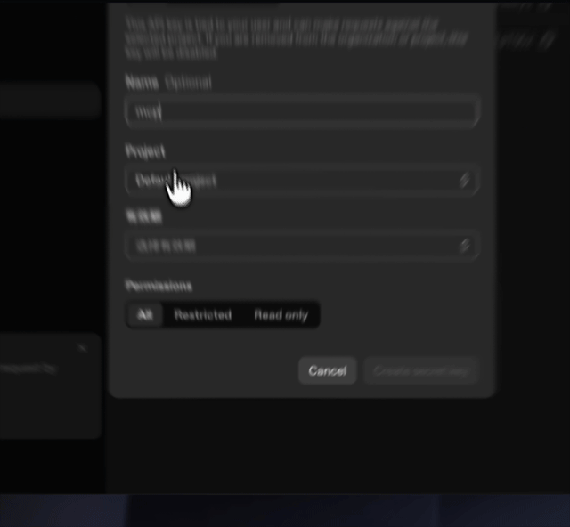
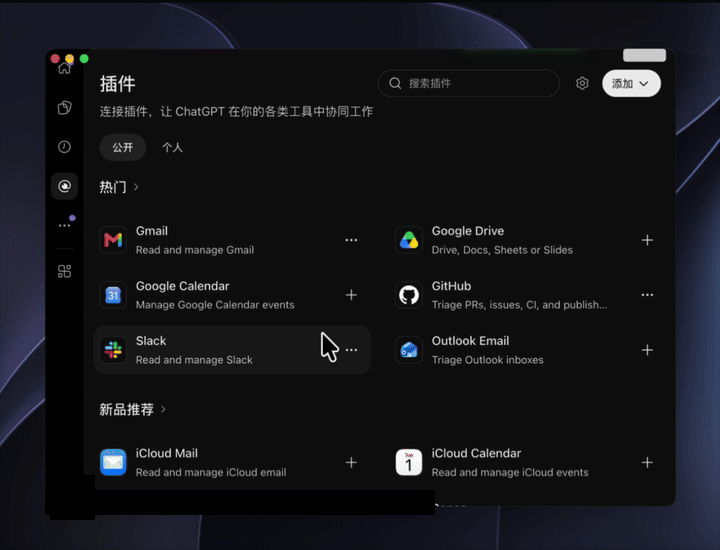

# macOS App 快速开始

适用于 Apple Silicon（M 系列芯片）、macOS 15 或更高版本。

## 1. 下载并打开 App

在 [下载页面](https://github.com/sc61561/Project-MCP/releases/tag/v0.2.1)下载 macOS 安装包，解压后将 Project MCP.app 放入“应用程序”文件夹并打开。

如果首次打开时提示无法验证开发者，请打开 **系统设置 → 隐私与安全性**，在“安全性”区域找到该 App 并点击 **仍要打开**，再按提示输入 Mac 登录密码并确认。“仍要打开”通常在尝试打开后的一小时内显示。[Apple 官方说明](https://support.apple.com/zh-cn/102445)

## 2. 获取连接信息

创建 [API Key](https://platform.openai.com/api-keys) 和 [Tunnel](https://platform.openai.com/settings/organization/tunnels)，将 Tunnel 关联到 ChatGPT 工作区。创建 API Key 时点击 `Create new secret key`，并妥善保存密钥。

## 3. 配置并启动

在 App 的设置中填写 API Key 和 Tunnel ID，保存后选择项目文件夹并启动。

## 4. 添加 ChatGPT 插件

打开 [ChatGPT 插件](https://chatgpt.com/plugins)，添加自定义 MCP 服务器：连接方式选择 **Tunnel**，选择刚创建的隧道，身份验证选择 **无身份验证**，然后创建并安装。

在对话中输入 `@` 选择插件，请它列出项目目录，以验证连接。“本地就绪”仅表示本地服务已启动。使用时保持 App 运行、电脑联网且处于唤醒状态。

## 5. 选择项目文件并启动

点击打开文件夹，选择需要 gpt 分析的项目文件（codex 的项目文件一般在`~/Documents/Codex/`或`~/Documents/Chatgpt/` 下）

选择后即可启动

在 chatgpt（无论电脑版还是手机版，无论网页还是 app），输入@‘你设定的插件名’，即可让 gpt 访问你的项目文件夹，并给出建议。

更多设置、常见问题和源码构建说明，请查看 [macOS 使用说明](macos-app.md)。
